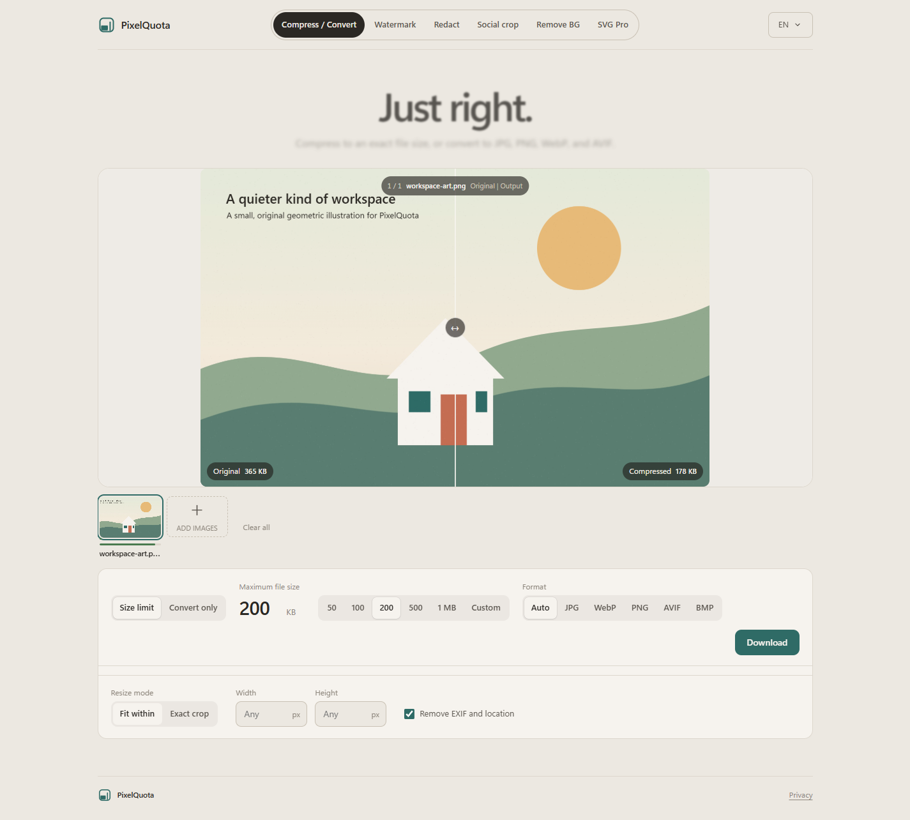

# PixelQuota

<div align="center">

**Private image tools. Right in your browser.**

Compress, convert, watermark, redact, crop for social platforms, remove backgrounds, and vectorize images without uploading selected image files to PixelQuota.

[**Live Demo**](https://kane1a.github.io/PixelQuota/) · [繁體中文](README.zh-TW.md) · [Changelog](CHANGELOG.md) · [Privacy](#privacy) · [Contributing](CONTRIBUTING.md)


</div>



## Six focused tools

| Tool | What it does |
| --- | --- |
| Compress / Convert | Target an actual KB limit, resize to exact or maximum pixel dimensions, or convert formats without forcing size reduction. |
| Watermark | Add text and/or image watermarks with a live preview, positioning, opacity, size, alignment, and full-resolution export. |
| Redact | Mark pixelated, blurred, or solid-block regions; move or resize them, undo/redo, and compare the exported result with the original. |
| Social Crop | Choose a platform preset and position the crop directly on the image. |
| Remove Background | Run BiRefNet Lite in the browser and export a transparent PNG at the source dimensions. |
| SVG Pro | Trace raster artwork into an editable SVG, inspect path/node statistics, and export SVG files. |

## Built for upload requirements

PixelQuota handles requirements such as **“under 100 KB,” “600 × 600 px,”** or **“JPG only.”** It checks the encoded output size and searches for the best result under the requested limit. If the size, format, and dimensions cannot all be satisfied together, it reports that instead of silently changing the request.

Conversion-only mode is separate from KB compression, so changing JPG / PNG / WebP / AVIF / BMP formats does not force unnecessary size reduction.

## Local AI background removal

AI Precision runs **BiRefNet Lite 512** in the browser. The first AI use downloads the Transformers.js runtime from jsDelivr and about 100 MB of FP16 model data from Hugging Face. Model responses can be stored in the browser's IndexedDB cache for reuse.

A cached model can avoid downloading its weights again, but it does **not** make first-time AI use offline or guarantee later offline use. PixelQuota reserves its persistent cache for model weights and required model definitions; it does not put the runtime, images, or language settings there. Runtime resources may need to be retrieved again. The browser can separately manage its own internal network-resource cache. Selected image files stay on the device and are not sent to an inference API.

The model produces a fixed-size alpha matte. PixelQuota reuses that matte for the preview and full-resolution transparent PNG composition rather than running the model again for each output step.

## Formats and limits

**Input:** JPG / JPEG / JPE / JFIF, PNG / APNG, WebP, AVIF, HEIC / HEIF / HIF, TIFF / TIF, GIF, SVG, BMP, and ICO. Decode support for browser-native formats can vary by browser; HEIC / HEIF and TIFF use the bundled `heic-to` and `utif2` decoders.

**Compression / conversion output:** JPG, PNG, WebP, BMP, and AVIF, with automatic format selection. AVIF export uses the bundled `@jsquash/avif` WebAssembly encoder. **SVG Pro** exports SVG; the HEIC conversion page exports JPG. ZIP downloads use `fflate`.

Animated image inputs export as static images. Multi-page TIFF reads only the first page. High-bit-depth input is normalized to 8-bit during image processing. Re-encoding may remove EXIF / GPS metadata.

Social presets are composition targets with fixed output dimensions, not simulations of a platform interface. Check the actual framing on the destination platform before publishing.

Current Chrome or Edge is recommended. General image processing is also checked in Firefox. Real AI acceptance uses WebGPU; other AI execution backends and Safari / iOS hardware have not been certified in this release.

## Privacy

- No image-upload endpoint and no account required.
- Compression, conversion, watermarking, redaction, cropping, previews, ZIP creation, vectorization, and final background-removal composition run in the browser.
- AI requires network access to fetch its runtime or model files when they are not available locally; selected image files are never sent to those services.
- Optional advertising or sponsorship configuration is separate from selected image files.

See the in-app [Privacy page](https://kane1a.github.io/PixelQuota/privacy.html) for details.

## Quick start

```bash
npm ci
npm run dev
```

Open the local Vite URL shown in your terminal.

### Production build

```bash
npm run build
```

The build creates:

- `dist/index.html` — static-host / GitHub Pages entry.
- `dist/PixelQuota.html` — self-contained standalone build that can be opened directly.

### Browser validation

```bash
npm run test:e2e
```

The Chrome / Chromium suite covers compression, conversion, format capability gating, watermarking, redaction editing and comparison, social crop, background-removal workflows, AI matte reuse, model-state UX, edge inspection, downloads, responsive layouts, and localization.

Set `CHROME_PATH` if Chrome / Chromium is installed in a non-standard location.

## GitHub Pages

The public app is available at **https://kane1a.github.io/PixelQuota/**.

This repository deploys through `.github/workflows/pages.yml`; pushes to `main` build and publish `dist/` automatically.

## Project structure

```text
src/                 App logic and image-processing engines
public/              Static configuration and privacy page
scripts/             Production / standalone packaging
tests/               Browser end-to-end validation
docs/images/         README screenshots
.github/             CI, Pages, issue and PR templates
```

## Contributing

Issues and pull requests are welcome. Start with [CONTRIBUTING.md](CONTRIBUTING.md).

Please **do not attach private IDs, forms, certificates, medical images, or other sensitive files** to public issues. Reproduce bugs with non-sensitive samples instead.

## License

PixelQuota source is released under the [MIT License](LICENSE). Third-party components keep their own licenses, including `heic-to` under LGPL-3.0, `utif2` under MIT, and `@jsquash/avif` under Apache-2.0. Keep the bundled [`licenses/` notices](public/licenses/THIRD-PARTY-NOTICE.txt) when redistributing the standalone package.
