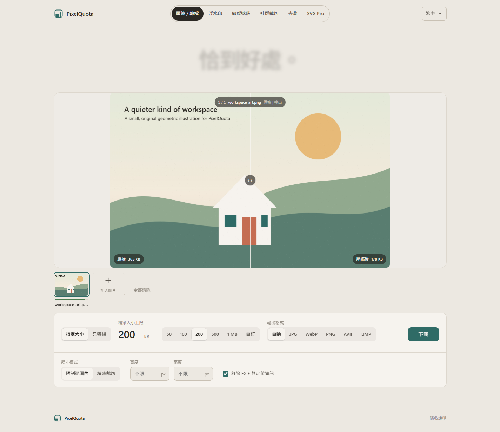

# PixelQuota

<div align="center">

**私密圖片工具，直接在你的瀏覽器裡完成。**

壓縮、轉檔、浮水印、敏感遮蔽、社群裁切、AI 去背與向量化，都不需要把你選取的圖片上傳到 PixelQuota。

[**線上直接使用**](https://kane1a.github.io/PixelQuota/) · [English](README.md) · [更新日誌](CHANGELOG.md) · [隱私](#隱私) · [參與貢獻](CONTRIBUTING.md)


</div>



## 六個工具，完成常見圖片工作

| 工具 | 功能 |
| --- | --- |
| 壓縮 / 轉檔 | 設定真正的 KB 上限、精確或最大像素尺寸，也可以只轉格式、不強迫縮小檔案。 |
| 浮水印 | 加入文字與圖片浮水印，可即時預覽、調整位置、透明度、大小與對齊，並以原尺寸輸出。 |
| 敏感遮蔽 | 標記像素化、模糊或實色遮蔽區，可移動、縮放、復原 / 重作，並比較輸出結果與原圖。 |
| 社群裁切 | 選擇平台尺寸，直接在圖片上調整裁切位置。 |
| 去背 | 在瀏覽器本機執行 BiRefNet Lite，輸出與原圖尺寸相同的透明 PNG。 |
| SVG Pro | 將點陣圖描繪成可編輯 SVG，檢視路徑 / 節點統計並匯出 SVG。 |

## 專門處理上傳限制

PixelQuota 可處理 **「100 KB 以下」、「600 × 600 px」、「只能 JPG」** 這類嚴格表單。它會檢查實際輸出的檔案大小，在上限內尋找最佳結果；若檔案大小、格式與尺寸無法同時符合，就會直接說明，不會偷偷更改需求。

「只轉檔」與 KB 壓縮分開，因此只需要 JPG / PNG / WebP / AVIF / BMP 時，不必為了改格式而降低檔案大小。

## 本機 AI 去背

AI 精準模式使用 **BiRefNet Lite 512** 在瀏覽器內執行。第一次使用 AI 時，會從 jsDelivr 下載 Transformers.js 執行環境，並從 Hugging Face 下載約 100 MB 的 FP16 模型資料。模型回應可存入瀏覽器 IndexedDB 快取供之後重用。

快取模型可避免再次下載模型權重，但**不代表第一次使用可以離線，也不保證之後都能離線使用**。PixelQuota 的持久快取只用於模型權重與必要模型定義，不保存執行環境、圖片或語言設定；執行環境可能需要重新取得。瀏覽器也可能另外管理網路資源的內部暫存。你選取的圖片檔案留在裝置本機，不會傳送到遠端推論 API。

模型會產生固定尺寸的 alpha matte。PixelQuota 重用同一張 matte 來產生預覽與原尺寸透明 PNG，不會為每個輸出步驟重新執行模型。

## 格式與限制

**輸入：** JPG / JPEG / JPE / JFIF、PNG / APNG、WebP、AVIF、HEIC / HEIF / HIF、TIFF / TIF、GIF、SVG、BMP 與 ICO。瀏覽器原生格式的解碼能力可能不同；HEIC / HEIF 與 TIFF 使用內建的 `heic-to`、`utif2` 解碼器。

**壓縮／轉檔輸出：** JPG、PNG、WebP、BMP、AVIF，並可自動選擇格式。AVIF 使用內建的 `@jsquash/avif` WebAssembly 編碼器。**SVG Pro** 輸出 SVG；HEIC 轉檔頁輸出 JPG。ZIP 下載使用 `fflate`。

動態圖片輸入會輸出為靜態圖片。多頁 TIFF 僅讀取第一頁。高位元深度輸入在圖片處理時會正規化為 8-bit。重新編碼可能移除 EXIF / GPS 中繼資料。

社群預設提供固定的構圖比例與輸出尺寸，不是平台介面的模擬。發布前，請再到目標平台確認實際構圖。

建議使用最新版 Chrome 或 Edge，一般圖片處理也已用 Firefox 補驗。真實 AI 驗收使用 WebGPU，其他 AI 執行後端及 Safari／iOS 實機尚未驗證。

## 隱私

- 沒有圖片上傳 API，也不需要帳號。
- 壓縮、轉檔、浮水印、遮蔽、裁切、預覽、ZIP、向量化與最後的去背合成都在瀏覽器內完成。
- AI 模型或執行環境不在本機時，需要網路下載；你選取的圖片檔案不會傳給這些服務。
- 選用廣告或贊助設定與你選取的圖片檔案分開。

完整說明請看使用者介面的 [Privacy 頁面](https://kane1a.github.io/PixelQuota/privacy.html)。

## 快速開始

```bash
npm ci
npm run dev
```

接著開啟終端機顯示的 Vite 本機網址。

### 建立正式版本

```bash
npm run build
```

Build 會產生：

- `dist/index.html`：GitHub Pages／靜態網站的輕量入口
- `dist/assets/`：同來源的程式、樣式與按需載入圖片編解碼元件，部署網站時需一併保留
- `dist/PixelQuota.html`：可直接雙擊的完整單檔版本，非 AI 圖片處理不需要本機伺服器或其他程式檔

### 瀏覽器驗證

線上版首次使用大型編解碼元件時需要網路。AVIF 的 WASM 下載暫時失敗可在同頁重試；若 JavaScript 模組載入失敗被瀏覽器保留，恢復連線後需重新整理。單檔版已內嵌這些非 AI 編解碼元件。

```bash
npm run test:e2e
```

Chrome / Chromium 測試涵蓋壓縮、轉檔、格式能力檢查、浮水印、遮蔽編輯 / 比較、社群裁切、去背流程、AI matte 重用、模型狀態、邊緣放大檢查、下載、響應式版面與多語系。

若 Chrome / Chromium 不在常見安裝位置，可設定 `CHROME_PATH`。

## GitHub Pages

公開版本：**https://kane1a.github.io/PixelQuota/**。

Repository 透過 `.github/workflows/pages.yml` 部署；push 到 `main` 後會自動 build 並發布 `dist/`。

## 專案結構

```text
src/                 App 與圖片處理引擎
public/              靜態設定與隱私頁
scripts/             Production / 單檔打包
tests/               瀏覽器端到端驗證
docs/images/         README 截圖
.github/             CI、Pages、Issue 與 PR 模板
```

## 參與貢獻

歡迎 Issue 與 Pull Request，請先閱讀 [CONTRIBUTING.md](CONTRIBUTING.md)。

請**不要在公開 Issue 上傳身分證件、申請文件、證書、醫療影像或其他敏感圖片**；請改用不含私人資訊的測試圖片重現問題。

## 授權

PixelQuota 原始碼採用 [MIT License](LICENSE)。第三方元件保留各自授權，包括 LGPL-3.0 的 `heic-to`、MIT 的 `utif2` 與 Apache-2.0 的 `@jsquash/avif`。重新散布單檔下載包時，請保留附帶的 [`licenses/` 授權與來源說明](public/licenses/THIRD-PARTY-NOTICE.txt)。
